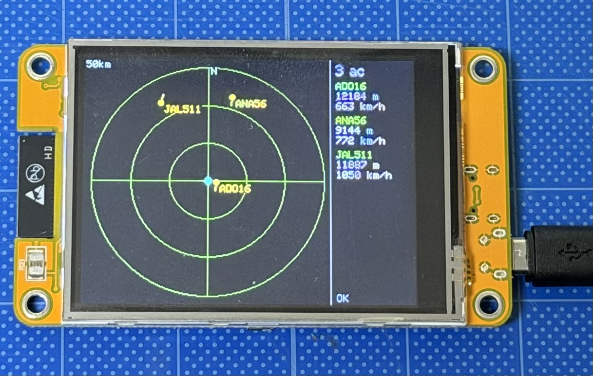

# CYD を使ったフライトレーダー
CYD（Cheap Yellow Display）は、ESP32マイクロコントローラーとタッチスクリーン付きカラー液晶が一体になった、非常に安価で人気の電子工作向け開発ボードです。
これを利用した Flightradar アプリです。

タッチスクリーンをタッチすると、表示範囲が 10→25→50→100 km に切り替わります。

画面の右側には航空機のIDと高度、速度が表示されます。

## 補足事項
* src/config.h に Wi-Fi の SSID とパスワードを入れる
* 中心座標は盛岡駅付近にしてあるので、必要なら変更
